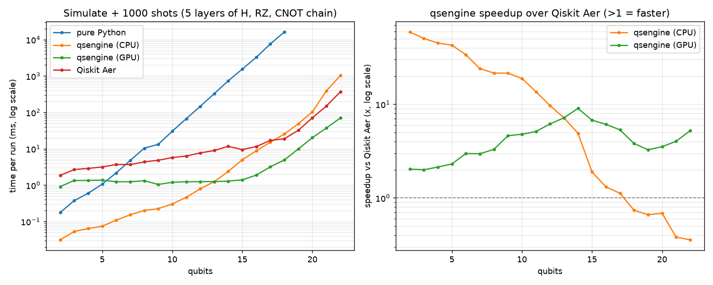

# qsengine: High-Performance Qubit Simulator
An end-to-end educational quantum computing platform consisting of:
1. **`qsengine`**: A blazingly fast state-vector simulator engine written in Rust, wrapped in an ergonomic Python API using **PyO3** and **maturin**.
2. **[qsengine.kaiwave.dev](https://qsengine.kaiwave.dev)**: A modern site covering foundational quantum mechanics, practical circuit building, and usage of qsengine.

---

### Project Scope Breakdown

| Component | Difficulty | Tech Stack | Notes |
| --- | --- | --- | --- |
| **Rust Core** | Medium | `nalgebra` or `ndarray` + Rayon | State vector simulation (tensor products, matrix multiplication) |
| **Python Bindings** | Low–Medium | `pyo3` + `maturin` | Expose circuit builder and gate applications |
| **Static Site** | Low | VitePress, Astro, or Docusaurus | Explains qubits, superposition, Bloch sphere, basic gates |

---

### Recommended 8-Week Timeline

**Weeks 1–2: State Vector Engine in Rust**

* Represent an $n$-qubit state as a complex vector of length $2^n$ (using `num-complex`).
* Implement single-qubit gates ($X, Y, Z, H$) via direct state indexing or Kronecker products.
* Add controlled gates ($CNOT$, $CZ$) and a basic measurement function using weighted random sampling.

**Weeks 3–4: Python Layer via PyO3**

* Initialize your workspace using `maturin new --binding pyo3`.
* Wrap a `QuantumCircuit` struct in Rust and expose methods like `.h(target)`, `.cx(control, target)`, and `.run()` to Python.
* Write unit tests in `pytest` to compare your simulation outputs against small NumPy calculations.

**Weeks 5–6: Performance & Benchmarking**

* Add multithreading to gate operations with **Rayon**.
* Benchmark execution times up to ~20 qubits against pure Python and basic Qiskit Aer to generate compelling performance plots.

**Weeks 7–8: Static Documentation Site**

* Use a doc generator with native KaTeX/MathJax support (like **VitePress** or **Starlight**).
* Cover foundational concepts: bra-ket notation, superposition, entanglement, and walk through an example algorithm (e.g., Deutsch-Jozsa or Quantum Teleportation) using your custom Python library.

### Potential Traps to Avoid

* **Exponential Memory Wall ($2^n$):** State vector memory scales as $2^n \times 16\text{ bytes}$. An 18-qubit simulation takes ~4 MB of RAM, 24 qubits takes ~256 MB, and 30 qubits demands ~16 GB. Cap your simulator's scope around 15–20 qubits before considering sparse matrices or stabilizer states.
* **FFI Boundary Overhead:** Avoid passing state vectors across the Rust-Python boundary on every single gate application. Keep the state entirely in Rust memory and only return counts or measurement bitstrings back to Python when `.measure()` or `.run()` finishes.
* 
---

## Architecture Overview

```
                      +-----------------------------+
                      |       Python Client         |
                      | (API / Circuit Construction)|
                      +--------------+--------------+
                                     |
                                     | PyO3 Bindings
                                     v
                      +-----------------------------+
                      |         Rust Core           |
                      |  - State Vector ($2^n$)      |
                      |  - Matrix Math & Rayon      |
                      |  - Non-destructive sampling |
                      +-----------------------------+
```

### Why Rust + Python?
Simulating an $n$-qubit quantum system requires maintaining a state vector of length $2^n$ with double-precision complex amplitudes ($\approx 16 \times 2^n$ bytes). Applying quantum gates translates to dense matrix multiplications and index shuffling.

* **Python** provides the approachable, interactive syntax familiar to researchers and students.
* **Rust** provides zero-cost abstractions, predictable memory usage, SIMD auto-vectorization, and data-race-free multithreading with `rayon`.
* **Zero FFI Boundary Penalty**: Circuits are constructed and fully executed in Rust memory. Complex state vectors are never serialized across the boundary on every gate—only final measurement results and expectation values are returned to Python.

---

## Repository Structure

```text
.
├── Cargo.toml               # Rust manifest (`gpu` feature on by default, `python` for maturin)
├── pyproject.toml           # Maturin build configuration
├── qsengine.pyi             # Python type stub (autocomplete + types in IDEs)
├── docs/RUST_GUIDE.md       # Every Rust feature used in the engine, explained
├── src/                     # Rust backend
│   ├── lib.rs               # Crate root, errors, BackendKind / best_backend()
│   ├── backend.rs           # QuantumBackend trait: shared API, measurement, conformance tests
│   ├── engine.rs            # QuantumState: multithreaded CPU state vector (f64)
│   ├── gpu.rs               # GpuQuantumState: portable GPU state vector via wgpu (f32)
│   ├── shaders/apply_gate.wgsl  # GPU kernel for every (controlled) gate
│   ├── gates.rs             # Pauli, Hadamard, S, T and rotation matrices
│   ├── circuit.rs           # QuantumCircuit: record gates, then run on any backend
│   ├── python.rs            # PyO3 bindings: qsengine.QuantumCircuit
│   └── main.rs              # Demo + CPU/GPU benchmark
├── tests/test_circuit.py    # pytest suite checked against a NumPy reference simulator
├── benchmarks/benchmark.py  # qsengine vs pure Python vs Qiskit Aer -> results.csv + benchmark.png
└── README.md
```

---

## Python Quickstart

```bash
python -m venv .venv
.venv\Scripts\activate            # Windows  (macOS/Linux: source .venv/bin/activate)
pip install maturin pytest numpy
maturin develop --release          # compile the Rust core and install `qsengine` into the venv
pytest                             # run the Python test suite
```

```python
import qsengine

qc = qsengine.QuantumCircuit(2)
qc.h(0)
qc.cx(0, 1)

qc.run(shots=1000, seed=1)        # {'00': 513, '11': 487}   qubit 0 is the rightmost bit
qc.statevector()                  # [(0.7071067811865476+0j), 0j, 0j, (0.7071067811865476+0j)]
qc.probabilities(backend="cpu")   # backend: "auto" (default), "cpu" (f64) or "gpu" (f32)
```

`"auto"` uses the GPU for circuits of 14+ qubits when one is available, otherwise the CPU. Bad input (e.g. `qc.h(5)` on 2 qubits) raises `ValueError`; asking for `"gpu"` without one raises `RuntimeError`.

---

## Performance



Each run simulates 5 layers of (H on every qubit → RZ on every qubit → CNOT chain), then samples 1000 shots. Times are the best of several runs on a Ryzen 5 5500 (6 cores) + Radeon RX 6600, Windows 10, Qiskit Aer 0.18.2.

| Qubits | Pure Python | qsengine CPU | qsengine GPU | Qiskit Aer |
|---:|---:|---:|---:|---:|
| 6  | 2.2 ms   | **0.11 ms** | 1.3 ms   | 3.7 ms   |
| 10 | 30 ms    | **0.30 ms** | 1.2 ms   | 5.8 ms   |
| 14 | 740 ms   | 2.4 ms      | **1.3 ms** | 11.7 ms  |
| 18 | 16.2 s   | 25 ms       | **4.9 ms** | 19 ms    |
| 22 | –        | 1.03 s      | **70 ms**  | 367 ms   |

* **Small circuits (≤ 13 qubits):** the CPU backend is 7–60x faster than Aer because there's almost no per-call overhead. It's also ~100x faster than pure Python at 10 qubits (and ~640x at 18).
* **Large circuits (≥ 14 qubits):** the GPU backend is 3–9x faster than Aer. The CPU backend falls behind Aer above ~17 qubits, where Aer's more aggressive (multi-qubit) gate fusion and cache blocking pay off.
* `backend="auto"` picks whichever is faster: CPU below 14 qubits, GPU from 14 when one is present.

Reproduce (needs `pip install qiskit qiskit-aer matplotlib`; Aer is skipped if missing):

```bash
python benchmarks/benchmark.py --max-qubits 22
```

---

## Features

- [x] **Full State-Vector Simulation**: Simulate systems up to ~20 qubits with minimal memory footprint.
- [ ] **Core Gate Set**:
  - **Single Qubit**: $X, Y, Z, H, S, T, R_x(\theta), R_y(\theta), R_z(\theta)$
  - **Multi Qubit**: $CX$ (CNOT), $CZ$, $SWAP$
- [x] **Measurement Engine**: Monte-Carlo shot sampling and exact state probability vector calculation.
- [x] **Multithreaded Gate Dispatch**: Parallelized matrix application across amplitude blocks via `rayon`, plus single-qubit gate fusion so runs of gates cost one pass over memory.
- [x] **Benchmarks**: Reproducible comparison against pure Python and Qiskit Aer up to 22 qubits (`benchmarks/`).
- [x] **Python API**: `qsengine.QuantumCircuit` via PyO3 + maturin; one abi3 wheel covers CPython 3.9+. The state stays in Rust and only results cross into Python.
- [x] **Portable GPU Backend**: wgpu compute shaders (Vulkan / DX12 / Metal, any vendor). Falls back to CPU automatically when no GPU is present; disable entirely with `--no-default-features`.
- [ ] **Accompanying Educational Site**: Clean, readable static guides explaining quantum mechanics from linear algebra up to full algorithms.
