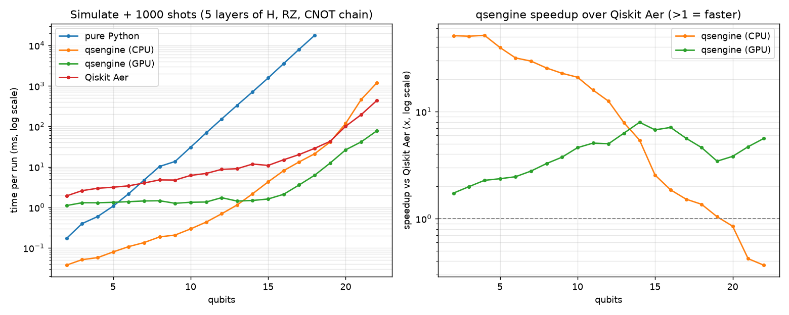

# qsengine

A state-vector quantum simulator for Python. You build circuits in Python; a Rust core runs them on every CPU core or on any GPU, and hands back the results.

```bash
pip install qsengine
```

```python
import qsengine

qc = qsengine.QuantumCircuit(2)
qc.h(0)
qc.cx(0, 1)

print(qc.run(shots=1000, seed=1))   # {'00': 513, '11': 487}
```

**Documentation and guides:** [qsengine.kaiwave.dev](https://qsengine.kaiwave.dev)

---

## Why qsengine

- **Fast where it counts.** Small circuits run on the CPU with almost no per-call overhead; from 14 qubits up, the GPU takes over. On a 22-qubit benchmark qsengine's GPU backend is about 5 times faster than Qiskit Aer.
- **Any GPU, nothing to install.** The GPU backend uses [wgpu](https://wgpu.rs), so it runs on NVIDIA, AMD, Intel and Apple GPUs through Vulkan, DirectX 12 or Metal. No CUDA, no vendor toolkit.
- **Works everywhere.** Without a usable GPU the same code runs on the CPU, in full 64-bit precision.
- **Small, plain API.** One class, nineteen gates plus any 2x2 unitary, mid-circuit measurement with classically controlled gates, and four ways to get a result: counts, probabilities, amplitudes and Pauli expectation values. Mistakes raise a normal Python `ValueError` on the line that made them.
- **Built to learn with.** The website walks from bra-ket notation to a complete Deutsch-Jozsa run, and every example on it is real qsengine output.

## Install

```bash
pip install qsengine
```

One wheel per platform covers CPython 3.9 and newer on Windows, macOS and Linux. A GPU is optional.

## Using it

A circuit has a fixed number of qubits, all starting in |0⟩. Gate methods record gates; nothing runs until you ask for a result.

```python
import qsengine

qc = qsengine.QuantumCircuit(3)
qc.h(0)
qc.cx(0, 1)
qc.cx(1, 2)

print(qc)                   # text drawing, one wire per qubit
qc.run(shots=1000)          # measurement counts: {'000': ..., '111': ...}
qc.probabilities()          # exact probabilities of all 8 basis states (NumPy array)
qc.statevector()            # exact complex amplitudes (NumPy array)
qc.expectation("ZZI")       # expectation value of a Pauli string: 1.0
```

### Measuring part-way

Give the circuit classical bits, measure into them at any point, and make later gates depend on them. Teleportation in full:

```python
qc = qsengine.QuantumCircuit(3, 3)  # 3 qubits, 3 classical bits
qc.x(0)                             # the state to teleport: |1>
qc.h(1)
qc.cx(1, 2)
qc.cx(0, 1)
qc.h(0)
qc.measure([0, 1], [0, 1])
with qc.if_test(1, 1):              # if classical bit 1 is 1
    qc.x(2)
with qc.if_test(0, 1):
    qc.z(2)
qc.measure(2, 2)
print(qc.run(shots=1000, seed=1))   # bit 2 (leftmost) is 1 in every shot
```

`qc.reset(q)` puts a qubit back to |0⟩ so it can be reused. When a circuit measures, `run()` counts the classical bits instead of the qubits.

| Gates | Methods |
| --- | --- |
| Single qubit | `x`, `y`, `z`, `h`, `s`, `sdg`, `t`, `tdg` |
| Angles (radians) | `rx(q, theta)`, `ry(q, theta)`, `rz(q, theta)`, `p(q, lam)`, `u(q, theta, phi, lam)` |
| Two qubit | `cx(control, target)`, `cz(control, target)`, `cp(control, target, lam)`, `crz(control, target, theta)`, `swap(q1, q2)` |
| Three qubit | `ccx(control1, control2, target)` |
| Any 2x2 unitary | `unitary(matrix, target, controls=[])` |
| Measurement | `measure(qubit, clbit)`, `reset(qubit)`, `with if_test(clbits, value):` |

Bitstrings put **qubit 0 on the right**, the same convention as Qiskit. Pass `seed` to `run()` for repeatable counts.

### Choosing a backend

Every method that runs a circuit takes `backend="auto"` (the default), `"cpu"` or `"gpu"`.

| | CPU | GPU | auto |
| --- | --- | --- | --- |
| Precision | 64-bit | 32-bit (within 1e-5 of the CPU) | 64-bit below 14 qubits, 32-bit from 14 |
| Runs on | every CPU core | any NVIDIA, AMD, Intel or Apple GPU | whichever is faster |
| Without a GPU | works | raises `RuntimeError` | falls back to the CPU |

The full API, every error message and a guide to each topic are in the [documentation](https://qsengine.kaiwave.dev/docs/).

## Performance

Each run simulates 5 layers of (H on every qubit, RZ on every qubit, CNOT chain) and samples 1000 shots. Best of at least three runs on a Ryzen 5 5500 with a Radeon RX 6600, Windows 10, Qiskit Aer 0.18.2.



| Qubits | Pure Python | qsengine CPU | qsengine GPU | Qiskit Aer |
| ---: | ---: | ---: | ---: | ---: |
| 6 | 2.2 ms | **0.11 ms** | 1.4 ms | 3.4 ms |
| 10 | 31 ms | **0.29 ms** | 1.3 ms | 6.1 ms |
| 14 | 713 ms | 2.2 ms | **1.5 ms** | 11.7 ms |
| 18 | 17.7 s | 21 ms | **6.2 ms** | 29 ms |
| 22 | not run | 1.17 s | **77 ms** | 431 ms |

Below 14 qubits the CPU backend is 8 to 50 times faster than Aer; from 14 qubits the GPU backend is 3 to 8 times faster. The CPU backend stays ahead of Aer up to 19 qubits and falls behind from 20, where Aer fuses multi-qubit gates. These are one machine's numbers: reproduce them with [`benchmarks/benchmark.py`](benchmarks/benchmark.py).

## Limitations

A register holds at most 30 qubits (16 GiB of memory) and 64 classical bits. A circuit that measures part-way is simulated once per shot, so it costs `shots` times as much as one that only measures at the end. Exact results (`statevector()`, `probabilities()`, `expectation()`) need a circuit that does not measure or reset before a later gate.

## Building from source

You need a recent Rust toolchain (tested with 1.88) and Python 3.9 or newer.

```bash
git clone https://github.com/kaiwave/qsengine
cd qsengine
python -m venv .venv
source .venv/bin/activate       # Windows: .venv\Scripts\activate
pip install maturin pytest numpy
maturin develop --release       # build and install into the venv
```

Tests:

```bash
cargo test --release            # Rust tests (GPU tests skip without a GPU)
pytest                          # Python tests, checked against a NumPy reference
```

See [CONTRIBUTING.md](CONTRIBUTING.md) for how the pieces fit together and how to add a gate.

To build without the GPU backend, use `cargo build --no-default-features` for Rust.

The website lives in `site/` (Next.js, static export, maths rendered with KaTeX at build time):

```bash
cd site
npm install
npm run dev                     # local preview
npm run build                   # static site in site/out/
```

Docs pages are Markdown (`site/app/docs/**/page.mdx`) with `$maths$`, tables and fenced code; `<Output printed="..." />` shows what a snippet prints. To add a page, create its `page.mdx` and list it in `DOCS` in `site/app/content.js`, which drives the sidebar and the previous/next links.

## Project layout

```text
src/                Rust core: all simulation
  engine.rs           CPU backend (64-bit, multithreaded with Rayon)
  gpu.rs              GPU backend (wgpu compute shaders in shaders/)
  circuit.rs          QuantumCircuit: records operations, fuses gates, runs them
  pauli.rs            Pauli-string expectation values
  python.rs           PyO3 bindings, built as qsengine._core
python/qsengine/    The Python package: wraps _core, adds the drawer and if_test, type hints
tests/              Python tests against NumPy
benchmarks/         Benchmark script, results and plot
site/               Documentation and learning website
docs/RUST_GUIDE.md  A guide to every Rust feature the engine uses
```

## Licence

MIT, see [LICENSE](LICENSE). Made by [kaiwave](https://kaiwave.dev).
